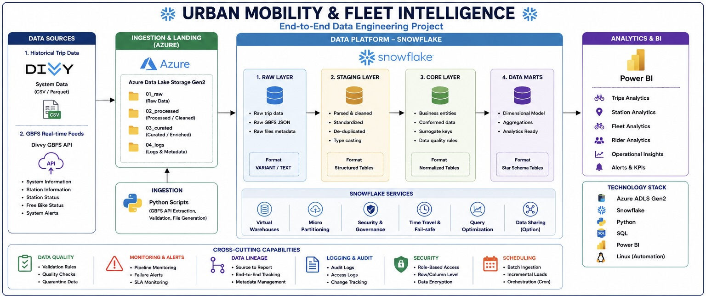

# 🚲 Urban Mobility & Fleet Intelligence

### End-to-End Data Engineering Project

A cloud-based platform that transforms urban mobility data into trusted analytical datasets for trip, station, fleet, and rider intelligence.



**Azure ADLS Gen2 → Azure Databricks / PySpark (optional) → Snowflake → Data Marts → Power BI**

## Project Overview

Historical Divvy trip data and GBFS mobility feeds are ingested, processed, validated, transformed, and served through analytical data marts.

**Stack:** Azure ADLS Gen2 • Azure Databricks • Apache Spark / PySpark • Snowflake • Python • SQL • Linux • Power BI

Databricks is being added as an optional distributed-processing path. The existing Snowflake workflow remains the validated baseline until a Databricks workspace, storage access, jobs, and reconciliation checks are configured and tested.

## Data Engineering Scope

- Batch and incremental ingestion
- Cloud data lake architecture
- Databricks notebooks and PySpark transformations
- Snowflake ELT pipelines
- JSON and semi-structured data processing
- Dimensional data modeling
- Data quality validation and quarantine
- Data lineage, monitoring, and error handling


## Technology Stack

| Category | Technology |
|---|---|
| Cloud | Microsoft Azure |
| Storage | Azure Data Lake Storage Gen2 |
| Distributed Processing | Azure Databricks / Apache Spark / PySpark (optional) |
| Data Warehouse | Snowflake |
| Data Transformation | PySpark / SQL / ELT |
| Programming | Python |
| Automation | Linux / Bash |
| BI | Power BI |
| Version Control | Git / GitHub |

## Databricks Integration (Optional)

Databricks provides a proposed Spark processing path for large historical trip CSVs and GBFS JSON snapshots stored in ADLS Gen2.

```text
Divvy CSV / GBFS JSON
        |
        v
Azure ADLS Gen2 (Bronze / landing)
        |
        v
Azure Databricks + PySpark
  - schema and type standardization
  - timestamp normalization
  - null and duplicate checks
  - invalid-record quarantine
        |
        v
Silver Parquet outputs
        |
        v
Controlled Snowflake ingestion / ELT
        |
        v
CORE tables → MARTs → Power BI
```

The Databricks path is optional and not yet represented as deployed. Do not run it alongside the current Snowflake route for the same batch unless duplicate handling is deliberately configured. Starter files and setup guidance are in [`databricks/README.md`](databricks/README.md).

## What Can It Answer?

- **Trips:** demand, duration, peak periods
- **Stations:** utilization, availability, demand
- **Fleet:** availability and operational trends
- **Riders:** usage patterns and behavior

## Documentation

- [01 — Business Requirements](docs/01_Business_Requirements.md)
- [02 — Source & Data Dictionary](docs/02_Source_and_Data_Dictionary.md)
- [03 — HLD / Architecture](docs/03_HLD_Architecture.md)
- [04 — Data Flow Diagram](docs/04_Data_Flow_Diagram.md)
- [05 — Data Model / Star Schema](docs/05_Data_Model_Star_Schema.md)
- [06 — Source-to-Target Mapping](docs/06_Source_to_Target_Mapping.md)
- [07 — Pipeline / ETL Design](docs/07_Pipeline_ETL_Design.md)
- [08 — Data Quality & Validation](docs/08_Data_Quality_Validation.md)
- [09 — Data Lineage](docs/09_Data_Lineage.md)
- [10 — Monitoring & Error Handling](docs/10_Monitoring_Error_Handling.md)
- [11 — Deployment / Runbook](docs/11_Deployment_Runbook.md)

## Existing Project Status

**Snowflake data platform completed and validated; Databricks extension is a starter implementation.**

The current Snowflake implementation supports historical trip ingestion, GBFS snapshot ingestion, Snowflake ELT, dimensional CORE tables, analytical MART tables, audit monitoring, and data-quality validation. Power BI consumes the curated MART layer.

Historical file automation is available in two patterns:
- Manual rerun: upload new CSV files to ADLS and run `sql/08_historical_ingestion.sql`.
- Optional Snowpipe/task automation: deploy `sql/15_historical_auto_ingestion.sql`, refresh the pipe in controlled mode, or configure Azure Event Grid for event-driven loading.

### Existing Snowflake Validation Snapshot

| Layer/Object | Row Count |
|---|---:|
| RAW_TRIPS | 869,051 |
| STG_TRIPS | 869,051 |
| FACT_TRIP | 565,273 |
| RAW_GBFS | 10 |
| STG_STATION_STATUS | 10,243 |
| STG_VEHICLE_STATUS | 15,588 |
| FACT_STATION_STATUS | 10,243 |
| FACT_VEHICLE_STATUS | 15,588 |
| MART_FLEET | 6 |

These counts describe the existing Snowflake baseline; they are not Databricks test results.

## Author

**Onkar Jadhav**

Aspiring Data Engineer

**SQL • Snowflake • Azure • Databricks • PySpark • Python • Data Engineering**
